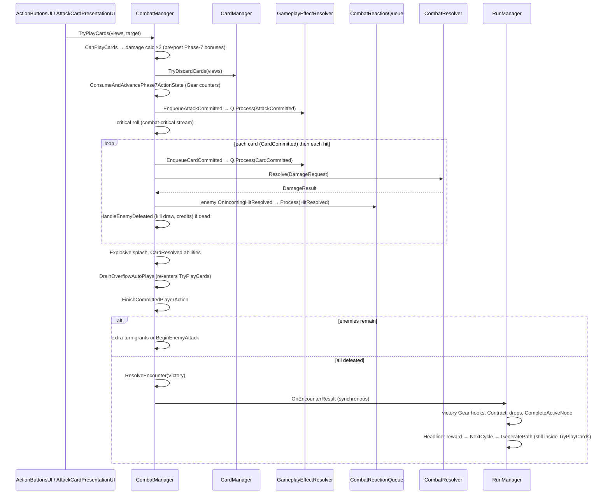
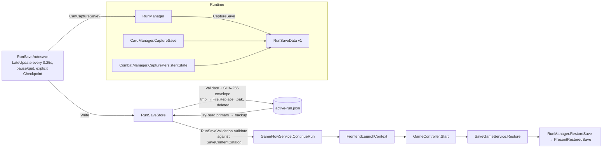
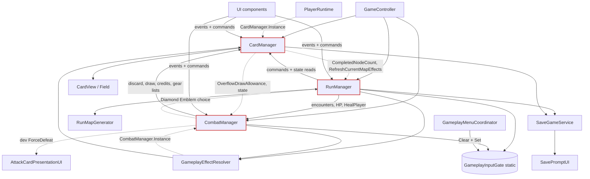
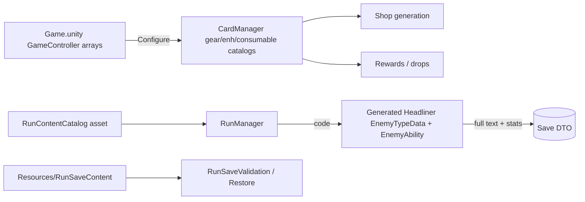
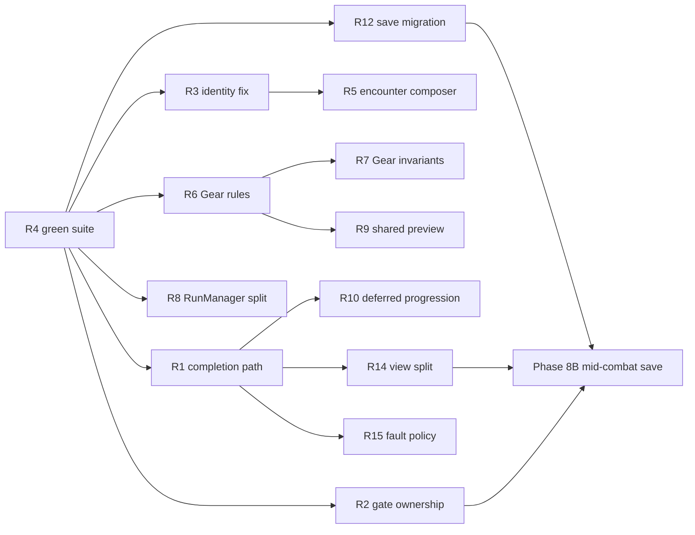
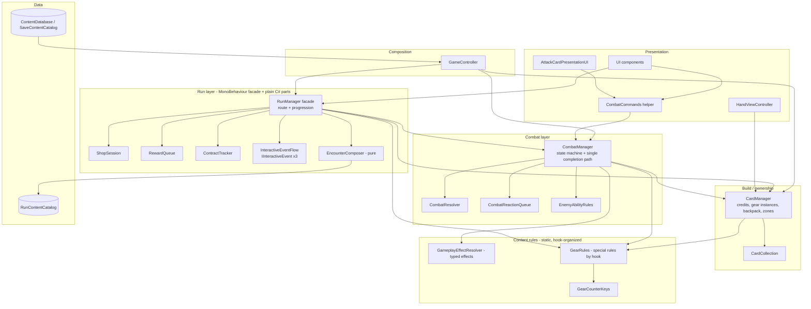

# Dealbreak Architecture Audit

**Date:** 2026-10-19
**Scope:** Whole Unity project (`Assets/Scripts`, authored content under `Assets/Data` and `Assets/Resources`, scenes, EditMode tests). Audit only: no gameplay code, assets or tests were changed.
**Baseline commit:** `b361db6` (Complete Dealbreak internal rebranding with save compatibility), branch `main`.

### Evidence used

| Evidence | What was done |
|---|---|
| Code reading | Read in full: `RunManager` (+Persistence), `CombatManager` (+Persistence), `CardManager` (+Persistence), `GameplayEffects.cs`, the combat foundation (`CombatResolver`, `CombatReactionQueue`, `DamageRequest/Result`, `CombatActionContext`), the runtime models (`EnemyRuntime`, `PlayerRuntime`, `CardInstance`, `CardCollection`), the persistence layer, `RunMapGenerator`, randomness, bootstrap/frontend flow, and the content definitions. Skimmed the UI layer for coupling patterns. |
| Asset inspection | Enemy assets (`Assets/Data/Enemies`), `PrototypeRunContent.asset`, `RunSaveContent.asset`, build scene list, `Game.unity` catalog references. |
| Automated tests | Ran the full **EditMode** suite through the Unity Test Runner (Locus): **624 tests, 606 passed, 18 failed** (35.5 s). PlayMode tests were **not** run. |
| Editor simulations | Throwaway `unity_execute` scripts using `HideFlags.DontSave` objects. No file changes; `git status` was unchanged afterwards. They reproduced three of the findings below. |

Findings are labelled **Confirmed (simulation)**, **Confirmed (test)**, **Confirmed (code)**, or **Potential risk**. A Potential risk is a hazard the code allows but that was not observed.

---

## 1. Executive Summary

Dealbreak's architecture is **sound at its core and strained at its edges**.

The foundations added over Phases 1–8A are well built:
- the authoritative card-zone model (`CardCollection`)
- named, context-derived deterministic RNG streams
- the structured combat pipeline (`DamageRequest` → `CombatResolver` → `DamageResult`, ordered `CombatReactionQueue`)
- a versioned, validated, crash-safe save store
- a presentation layer that commits gameplay first and animates snapshots afterwards

These are better than typical for a prototype-stage roguelike and should be kept.

The strain comes from how content was added on top of them:

- **Content-specific rules live inside the three central managers.** `GearSpecialRule` has 51 values, and about 94 switch/equality checks on it are spread across `RunManager`, `CombatManager`, `CardManager` and `GameplayEffectResolver`. Per-Gear state uses about 15 magic negative counter keys (`-1382`, `-140`, …). Enemy composition and support rules compare **player-facing display names** (`"Goblin"`, `"War Drummer"`, `"Knight"`). The recent rebrand already broke one of these: the Goblin asset's `enemyName` is now `"Scrapper"`, so the Captain aura silently stopped working.
- **The managers are god classes.** `RunManager` is 2,574 lines with roughly 45 private state fields. It owns route progression, encounter composition, Shop, Services, Contracts, Blood Ritual, Hammer, consumable reward queueing, Gear victory hooks and save capture. `CombatManager` (1,989 lines) holds an attack method of about 260 lines with two branches and Gear-specific action bonuses.
- **Cross-cutting state has no owner.** `GameplayInputGate` is a global flag set written by both gameplay (`RunManager`) and UI (`GameplayMenuCoordinator`). The coordinator *clears every reason* whenever a menu opens or closes, which silently unblocks pending gameplay choices.
- **The regression gate is not in use.** The EditMode suite is red (18 failures). The development log records that recent phases shipped with "0 run" automated tests.

Three defects found during the audit were reproduced in the editor:

1. **Softlock (Critical):** killing the last enemy with a damage Trick while blocking leaves combat permanently in `EnemyAttacking`, with no legal action.
2. **Modal bypass (High):** opening and closing the Pause menu removes the `GearChoice` and `ConsumableReward` input blocks.
3. **Rebrand regression (High):** the Captaincy aura never applies to the real Scrapper (Goblin) asset. The Captain and War Drummer route previews understate the encounter.

**Verdict:** incremental improvement is clearly feasible and a rewrite is not justified. The highest-value work is small and local: one post-action completion path in combat, input-gate reason ownership, and identity-based (not name-based) enemy rules. After that, consolidating Gear rules and splitting `RunManager` into plain C# collaborators behind its current public API.

---

## 2. Current Architecture Overview

### 2.1 Layers as they actually exist

| Layer | Contents | Notes |
|---|---|---|
| **Bootstrap / Frontend** | `Bootstrap` (`RuntimeInitializeOnLoadMethod`), `GameFlowService`, `FrontendLaunchContext` (static hand-off), `GameplayInputGate` (static flags), `GameplayMenuCoordinator`, `PauseMenuUI`, `SavePromptUI`, settings | Scene transitions between `MainMenu` and `Game`. The `Bootstrap.unity` scene is in the build list but unused. |
| **Composition root** | `GameController` (`Game.unity`, `[DefaultExecutionOrder(-50)]`) | Finds or creates the three manager singletons, injects scene references and catalog arrays, attaches autosave, then starts or restores a run. |
| **Run / meta** | `RunManager` (partial; `.Persistence`) | Route, encounters, Shop and Services, Events/Risks/Upgrades, Contracts, rewards, Headliner progression, infinite mode, timing. |
| **Combat** | `CombatManager` (partial), `CombatResolver`, `CombatReactionQueue`, `DamageRequest/Result`, `CombatActionContext`, `EnemyRuntime`, `PlayerRuntime`, `EnemyAbility` (SO) | The turn state machine (`Idle → PlayerTurn ⇄ EnemyAttacking → GameWon/GameOver`). |
| **Cards / build** | `CardManager` (partial), `CardCollection`, `CardInstance`, `CardData` (SO), `DeckMutationService`, `ConsumableStack/Instance`, `GearRuntimeInstance` | Credits, Gear ownership, backpack, deck zones **and** hand `CardView` lifecycle, selection, drag and targeting modes. |
| **Effects** | `GameplayEffectResolver` (static, 1,170 lines) + typed `GameplayEffectDefinition` / `GameplayRuleModifierData` on `GearData` and `CardEnhancementData` | Data-driven numeric and reactive effects plus `GearSpecialRule` special cases. |
| **Content** | `GearData` (74), `CardEnhancementData` (12), `ConsumableData` (20), `EnemyTypeData` (10), `EnemyAbility` (12), `RunEventDefinition` (13), `RunContentCatalog`, `SaveContentCatalog` | Authored ScriptableObjects. Headliners and their abilities are **generated in code**. |
| **Generation / RNG** | `RunMapGenerator` (static, pure), `RunRandomContext`, `DeterministicRandom`, `EnemyMapScaling`, `InfiniteRunScaling` | Named streams derived from seed, stream name and context. |
| **Persistence** | `RunSaveData` (DTOs), `RunSaveValidation`, `RunSaveStore`, `SaveGameService`, `RunSaveAutosave` | JSON envelope with SHA-256, atomic replace, backup, and a tombstone on delete. |
| **Presentation** | ~25 UI MonoBehaviours, `CardView`, `Field`, `AttackCardPresentationUI` | Subscribe to manager events in `OnEnable`/`OnDisable` and call manager commands directly. |

### 2.2 Size and concentration

| File | Lines | Share of the 20,075 runtime lines |
|---|---:|---:|
| `Managers/RunManager.cs` + `.Persistence.cs` | 2,574 | 12.8% |
| `Managers/CombatManager.cs` + `.Persistence.cs` | 1,989 | 9.9% |
| `Combat/GameplayEffects.cs` | 1,631 | 8.1% |
| `Managers/CardManager.cs` + `.Persistence.cs` | 1,488 | 7.4% |
| `UI/ActionButtonsUI.cs` | 1,000 | 5.0% |

Four gameplay files hold about 38% of the runtime code and nearly all of the rules.

### 2.3 Phase 7B.5 status

`AGENTS.md` still lists *Combat Resolution Foundation* as "next proposed". It is **implemented**:
- `DamageRequest` / `DamageResult` / `CombatResolver`
- per-hit Shield charges on `PlayerRuntime` and `EnemyRuntime`
- a multi-hit `DoubleStrike` enhancement
- a FIFO `CombatReactionQueue` with a runaway guard (256 operations)
- `CombatActionContext` with stable action IDs

Its tests (`Phase7B5CombatFoundationTests`, `Phase7B5CombatCharacterizationTests`) pass. The Recover–Shield policy was finalized in `795cb2e` (Recover is one aggregate hit with `allowShield: true`). The planned-work section of `AGENTS.md` is stale (see LEG-07).

---

## 3. System Responsibility Map

| Responsibility | Owner today | Also touched by | Assessment |
|---|---|---|---|
| Run lifecycle (start/restart/abandon/complete) | `RunManager` | `GameFlowService`, `PauseMenuUI`, `Bootstrap.OnSceneLoaded` (Reset ×3) | Acceptable |
| Route generation | `RunMapGenerator` (pure) | `RunManager.GeneratePath`, Gear `MapReady` hooks | **Good** |
| Route state and node progression | `RunManager.currentPath`, `CompleteActiveNode` | Save restore, UI reads `PathNode` fields directly | Acceptable; `PathNode` is a public mutable class |
| Encounter composition (allies, elites) | `RunManager.TryStartEncounter` | Preview (`GetNormalEncounterPreview`, `GetElitePreviewDescription`), `CombatManager` (Captain aura) | **Duplicated and name-keyed** |
| Headliner identity, abilities, names | `RunManager.CreateHeadlinerType/CreateAbility/GetCanonicalHeadlinerName` | Save DTO stores generated text | Hardcoded content in a manager |
| Combat state machine | `CombatManager` | Tests write `currentState` and `pendingDamage` directly | Public mutable state |
| Damage math | `CombatResolver` + target `ModifyIncomingCombatDamage` | `GameplayEffectResolver` (incoming reductions, Glass/Arsenal) | **Good structure**; modifiers are impure (Guarded/SuitCall consume state) |
| Attack value | `GameplayEffectResolver.CalculateAttack` | `CombatManager.CalculateCardAttackDamage` (opening/action bonuses), `CardView` label | Preview and execution diverge for action bonuses |
| Reaction ordering | `CombatReactionQueue` | Effects enqueue with phase, category, source order and handler order | **Good** |
| Card zones | `CardCollection` | Everything goes through it | **Good** |
| Hand views, selection, drag, targeting | `CardManager` | `ActionButtonsUI`, `CardView`, `EnhancementTargetUI` | Mixed into the model manager |
| Credits | `CardManager.credits` (public field) | `RunManager`, `CombatManager`, effects | Public mutable field; `PurchaseExistingDraw` bypasses `SpendCredits` |
| Gear ownership | `CardManager.ownedGear` + `_orderedGearInstances` + `gearIds` | `RunManager` (Shop, rewards), tests mutate `ownedGear` | **Three parallel structures**; duplicate rule enforced only at some call sites |
| Gear effects | `GameplayEffectResolver` (typed) | `RunManager` (12 rules), `CombatManager` (15 rules), `CardManager` (8 rules) | **Split execution paths** |
| Enemy abilities | `EnemyRuntime` (flag queries) | `EnemyAbility` virtuals (3 effects), `CombatManager` (Captain, Master Thief, Suit Call), resolver (Silence) | Scattered |
| Consumables (Tricks) | `CardManager` | `CombatManager.TryUseConsumableDamage`, `RunManager` (rewards, Shop) | Acceptable |
| Shop / Services / Contract / Investment | `RunManager` | `ShopUI` | Should be its own collaborator |
| Interactive events (Blood Ritual, Contract choice, Hammer) | `RunManager` via string IDs and runtime-created `RunEventDefinition` | `RunEventUI` | Special-cased |
| Input blocking | `GameplayInputGate` (static) | `RunManager`, `GameplayMenuCoordinator`, `SavePromptUI`, `RunResultUI` | **No ownership; reasons overwritten** |
| Save capture and restore | Owner partials + `SaveGameService` | `RunSaveAutosave` polling | **Good contracts**; strict v1 only |
| Content registries | `GameController` arrays (scene), `RunContentCatalog`, `SaveContentCatalog` | — | Three hand-kept lists |

---

## 4. Runtime Execution Flow

### 4.1 Startup and run initialization

1. `Bootstrap.Initialize` (`BeforeSceneLoad`) creates `[Bootstrap]` with `GameFlowService` (`DontDestroyOnLoad`). The first enabled build scene is `MainMenu`.
2. The Main Menu calls `GameFlowService.StartRun(seed)` or `ContinueRun()`. Continue validates the save, stores it in `FrontendLaunchContext`, and loads `Game`.
3. `GameController.Awake` (order −50) runs `GetOrCreate<CardManager/CombatManager/RunManager>()`. The managers are `DontDestroyOnLoad` singletons. Awake then configures catalogs and scene references and runs `SaveGameService.Attach(run)` (adds `RunSaveAutosave`).
4. `GameController.Start` takes one of three paths:
   - restore a pending Continue
   - start with a pending seed
   - auto-resume a valid save, or fall back to `StartRun()`
5. `RunManager.StartRunWithSeed` (`RunManager.cs:183`) does the following, in order:
   - deletes the old save
   - creates a new `RunRandomContext`
   - resets combat and assigns the `combat-critical` and `duelist-suit` streams
   - resets cards and the run's runtime state
   - assigns the `cards` stream
   - `BuildDeck` (40 cards) → `DealHand`
   - `BuildHeadlinerDeck` (J, Q, K tiers, suits shuffled per tier, generated abilities)
   - `NextCycle()` (generates District 0, queues the Alchemist reward, shows the path screen)
   - writes a forced checkpoint
6. Returning to the Main Menu triggers `Bootstrap.OnSceneLoaded`, which resets all three managers. The managers survive the scene change while holding references to destroyed Game-scene objects (`handField`, `dragCanvas`). Null checks keep this safe.

### 4.2 Route and node flow

`OnPathChosen(id)` (`RunManager.cs:488`):
1. Validates the gate and state.
2. **Writes a checkpoint before committing.**
3. Marks the column inaccessible.
4. Dispatches on `node.kind`:
   - **Combat / Elite / Headliner:** `TryStartEncounter` → `CombatManager.TryStartEncounter`
   - **Shop:** `PrepareShopOffers` (cached per map and node; resolves Investments)
   - **Upgrade:** offers a free Mod (Enhancement)
   - **Event / Risk:** looks up `RunEventDefinition` by `contentId`

Completion goes through `CompleteActiveNode` (`RunManager.cs:2236`):
1. completed flag and counters
2. `ApplyPhase7MapCompletionEffects` (hardcoded Gear)
3. unlocks successors
4. `GameplayEffectResolver.ApplyNodeCompleted` (typed Gear)
5. `RefreshCurrentMapEffects`
6. `TryOpenHammerReward`

Then `ShowPathAfterNode` writes a checkpoint.

### 4.3 Combat flow

On the defense side:
- `TryDefendWithCards` matches cards to attacks (full-coverage first), recycles the cards to the deck, and processes `AttackBlocked` then `HitResolved` reactions (Retaliation, Spade draw).
- `TakeRemainingDamage` sends ordinary attacks as **one aggregate hit** plus separate Double-Strike hits (the invariant is preserved).
- Perfect Block is evaluated over the whole response window.

### 4.4 Shop, rewards and progression

- **Shop goods** come from three seeded shuffles (Gear, enhancement-Tricks, other Tricks), with slot counts that differ for mid-route and pre-Headliner Shops. **Services** are two of Guidance, Contract, Investment and Supply (seeded). Purchases run inside `_shopTransaction` and always end with `OnShopOffersChanged` and a checkpoint.
- **Victory:**
  - `CombatManager.ResolveEncounter` adds credits (Bounty Ledger, typed `EncounterWon` effects).
  - `RunManager.HandleEncounterResult` then applies Gear victory hooks, Contract progress, a consumable drop (only if an enemy was *killed*; fleeing grants nothing), node completion, and, for a Headliner, the exact face-card reward followed by Contract settlement, then either `NextCycle` or `OnRunCompleted`.
- **Defeat:** `RunSaveAutosave.EncounterEnded` deletes the save, and `RunResultUI` shows the result once presentation is idle.

### 4.5 Save / Load

Saves happen only at "safe-node" checkpoints: on the route, or inside a Shop, Event or Upgrade, with no pending prompts and combat `Idle` or `GameWon`. Combat is never serialized: quitting mid-fight resumes from the checkpoint written in `OnPathChosen` just before the encounter started.

### 4.6 Victory, defeat and restart

- **Final Headliner:** reward → `Timing.StopRun` → `IsRunCompleted` → `OnRunCompleted` (the save is deleted). Infinite mode can then continue (`ContinueInfiniteMode`).
- **Restart:** `PauseMenuUI.RestartSameSeed` calls `RunManager.RestartRun` in the same scene. Every manager resets, and the UI resets via `OnRunStarted`.
- **Abandon:** deletes the save, then loads `MainMenu`.

### 4.7 UI synchronization

UI components subscribe to roughly 40 C# events across the managers in `OnEnable` and unsubscribe in `OnDisable`; this discipline is consistent. Commands are direct method calls on `XManager.Instance`. Presentation follows a **commit-then-animate** model: `AttackCardPresentationUI` snapshots the views, calls the authoritative command, and animates copies. Route and result panels wait on `IsBusy`. Gameplay never waits for animation, which is the correct direction.

---

## 5. Dependency and Data Flow Diagrams

### 5.1 Actual runtime dependencies

Dotted edges are hidden `Singleton.Instance` reads from code that otherwise looks parameterized. `RunManager`, `CombatManager` and `CardManager` form a **dependency cycle**. Each reaches the others through static `Instance`.

### 5.2 Content to runtime data flow

The three registries must be kept aligned by hand. For example, `DoubleStrikePatch.asset` appears in none of them.

---

## 6. System-by-System Assessment

Rating scale: **Strong / Adequate / Weak**. Risk: **Low / Medium / High**.

### 6.1 Core architecture

| Criterion | Rating | Justification |
|---|---|---|
| Responsibility clarity | Weak | Three managers own overlapping concerns (credits, Gear effects and node counters are reached from all three). |
| Coupling | Weak | Cyclic singleton access; static resolver reads `CombatManager.Instance` inside attack math (`GameplayEffects.cs:644,658,674,698`); `PlayerRuntime` reads `CardManager.Instance` (`PlayerRuntime.cs:62`). |
| Cohesion | Weak (managers) / Strong (models) | `CardCollection`, `DeterministicRandom`, `CombatResolver` and `RunSaveStore` each do one thing. |
| Init and teardown | Adequate | Explicit composition root, `DefaultExecutionOrder`, consistent `OnEnable`/`OnDisable` subscription. Managers outlive the Game scene while holding scene references. |
| Lifetime | Adequate | `Singleton<T>` never auto-creates (good). Statics (`GameplayInputGate`, `FrontendLaunchContext`, `GearRuntimeInstance.s_nextId`, `DevModeRuntime`) survive across runs and tests. |
| **Risk** | **High** | Most cross-system defects found here come from this coupling. |

### 6.2 Run and map

| Criterion | Rating | Justification |
|---|---|---|
| Responsibility clarity | Weak | `RunManager` is the shop, event engine, contract system, reward queue and encounter composer at once. |
| Generation | **Strong** | `RunMapGenerator` is static and pure. It uses separate `map-layout`, `map-content`, `map-elite-*` streams per map index, a structural elite rule (never the only successor), and fixed Shop checkpoints. |
| District scaling | Strong | `EnemyMapScaling` / `InfiniteRunScaling` are pure, use decimal rounding, and are tested. |
| Encounter composition | Weak | Name-keyed, and preview and spawn are implemented separately (see CX-03). |
| Determinism | Strong | All run-side randomness uses `CreateStream(name, context)`. No `UnityEngine.Random`, no hash-iteration order. |
| Extensibility | Weak | A new enemy that needs allies, map gating or elite exclusion requires edits in `RunMapGenerator.PickContentId`, `RunManager.TryStartEncounter`, `ShouldAddGoblinAlly` and the two preview methods. |
| **Risk** | **High** | |

### 6.3 Combat

| Criterion | Rating | Justification |
|---|---|---|
| CombatManager vs CombatResolver split | **Strong** | `CombatResolver` (44 lines) is pure per hit: modifiers → Shield → HP → lethal. `CombatManager` orchestrates the sequence. |
| Turn/state transitions | Adequate | Explicit `GameState`, but terminal-state detection is repeated in each command path, and one path misses it (CX-01). |
| Damage/Block | Strong | Aggregate retaliation invariant kept; full-coverage matching is deterministic; Perfect Block uses a preview that doesn't consume Encounter Block. |
| Card ownership | Strong | Commands validate `CardView` → `CardInstance` membership in the hand and commit through `CardCollection`. |
| Reaction ordering | **Strong** | Phase, then source category, source order, handler order, priority, hit index and action ID. Deduplicated keys and a runaway guard. |
| Effect execution | Weak | Typed effects coexist with about 15 `GearSpecialRule` blocks inline in `CombatManager` (`PreparePhase7ActionBonuses`, `ConsumeAndAdvancePhase7ActionState`, `TryReturnCriticalAce`, `AwardDevouringKillBonus`, `ResolveEncounter` Bounty Ledger, encounter-start Gear). |
| Enemy abilities | Weak | `EnemyAbility` virtual hooks implement 5 of 20 effects; the rest are flag checks in `EnemyRuntime` and `CombatManager`. There are no subclasses, so the virtual-method design does no work. |
| Event cleanup | Strong | Enemy `OnHpChanged`/`OnAttackChanged` are unsubscribed on removal, resolution and reset. |
| Reentrancy | Adequate | Guarded by `_isResolvingAction`, but Overflow auto-play re-enters `TryPlayCards`, and victory runs the whole run progression inside the action's `try` (CX-06). |
| Duplicate resolution | Strong | `_processedEnemyDeaths`, `_encounterResolved` and `_parryResolved` make death, reward and terminal outcomes once-only. |
| Testability | Adequate | Heavily tested (multi-enemy, 7B.5 characterization). Tests must build `CardView`s and set public state fields directly. |
| **Risk** | **High** | Driven by CX-01. Otherwise Medium. |

### 6.4 Content and data

| Criterion | Rating | Justification |
|---|---|---|
| ScriptableObject usage | Adequate | Authored SOs for Gear, Mods, Tricks, enemies and events. Runtime state is kept off SOs, which is good. **Headliners, their abilities and the interactive event definitions are created at runtime with `ScriptableObject.CreateInstance` and destroyed by hand.** Each card instance also gets its own runtime `CardData` SO. |
| Typed effect system | Strong design / partial adoption | `GameplayEffectDefinition` (kind, trigger, amount, conditions) plus `GameplayRuleModifierData` is a good, small vocabulary. About half the Gear relies on `specialRule` instead. |
| Hardcoded rules | Weak | See §7. |
| Validation | Weak | No content-consistency test across the scene catalogs, `RunSaveContent` and `RunContentCatalog`. The rebrand changed a gameplay-significant `enemyName` without failing any test except one preview test, which was not being run. |
| **Risk** | **Medium-High** | |

### 6.5 State management

| Criterion | Rating | Justification |
|---|---|---|
| Authoritative state | Strong (cards, HP) / Weak (Gear) | `CardCollection` and `PlayerRuntime` are authoritative. Gear is three parallel structures, silently repaired by `EnsureGearInstances` (`CardManager.cs:684`). |
| Mutation boundaries | Weak | Public mutable fields: `CombatManager.currentState`, `currentEnemy`, `pendingDamage`; `CardManager.credits`, `ownedGear`, `gearIds`; `RunManager.headlinerDeck`, `headlinerIndex`, `currentPath`. |
| UI vs gameplay | Adequate | Selection, targeting and drag state live in `CardManager` next to the model. |
| Reset correctness | Adequate | `ResetRuntimeState` (`RunManager.cs:2349`) is long and manual (≈60 assignments). Every new field must be added there, to `CaptureSave`, to `RestoreSave` and to the DTO. |
| Global flags | Weak | `GameplayInputGate` has no ownership semantics (CX-02). |
| **Risk** | **Medium-High** | |

### 6.6 Save / Load

| Criterion | Rating | Justification |
|---|---|---|
| Serialization boundary | **Strong** | Value-only DTOs with stable content IDs; no Unity references or callbacks. |
| Integrity | **Strong** | Validate-before-write, SHA-256 envelope, temp + `File.Replace`, refusal to back up a corrupt primary, tombstone deletion, 8 MiB cap. |
| Checkpoint consistency | Strong | `CanCaptureSave` excludes combat, transactions and pending prompts. The route checkpoint is taken *before* commit. |
| RNG restoration | Strong | Exact xorshift state for consumed streams; derived streams recompute from context. |
| Partial failure | Adequate | Full validation happens before `RestoreSave`. If restore still throws midway, the managers are left half-reset (autosave is suspended, the user is sent to the menu). |
| Versioning / migration | Weak | `version == 1 && contentVersion == 1` exactly, with no migration pipeline. `JsonUtility` silently defaults missing fields. Generated Headliner text is persisted verbatim. |
| Performance | Adequate | Captures and serializes a full snapshot every 0.25 s on safe screens to detect changes. |
| **Risk** | **Low-Medium** | |

### 6.7 UI

| Criterion | Rating | Justification |
|---|---|---|
| Gameplay/UI coupling | Adequate | UI holds no gameplay rules (no `specialRule` or name checks found). Large controllers (`ActionButtonsUI` 1,000 lines; `ShopUI` 713) duplicate command routing (the `presentation != null ? presentation.TryX : combat.TryX` pattern appears in at least 4 places). |
| Event-driven sync | Strong | Consistent subscribe/unsubscribe; idempotent refresh methods. |
| Selection state | Adequate | Owned by `CardManager` and validated by `CombatManager`. |
| Lifecycle | Adequate | `RunEventUI` is reused for events, upgrades and Gear choices, and `Hide()` discards a pending choice callback without invoking it (`RunEventUI.cs:559`). |
| Scene/prefab dependencies | Adequate | Explicit inspector references; a few `FindFirstObjectByType` fallbacks. |
| **Risk** | **Medium** | |

### 6.8 Engineering quality

| Criterion | Rating | Justification |
|---|---|---|
| Testability | Adequate | 624 EditMode tests, many targeted. Testing needs the singletons, `CardView` instances and reflection into private fields (`SetPrivate`, `Invoke(_run, "TryOpenHammerReward")`). |
| Regression discipline | **Weak** | 18 of 624 EditMode tests fail at HEAD. `DEALBREAK_DEVELOPMENT.md` documents phases accepted with "0 run" tests. |
| Error handling | Adequate | Commands return `bool`; route-start rollback; save errors surfaced to the user. The reaction runaway is converted to a run **Defeat**, which deletes the save (TD-15). |
| Logging | Adequate | `CombatManager.Log` echoes every combat line to `Debug.Log`, which is noisy in builds. |
| Performance | Adequate | LINQ in hot-ish getters (`HasAbility`, `HandCapacity`, `Backpack`) is negligible at current scale. The autosave poll allocates continuously. |
| DI | n/a | Singletons plus a composition root. Appropriate for this project size; a DI container is **not** recommended. |

---

## 7. Hardcoded Logic Inventory

Categories: **A** reasonable core rule · **B** configuration value that should be data · **C** domain logic in the wrong subsystem · **D** obsolete legacy · **E** unnecessary abstraction.

### 7.1 Enemy identity and encounter composition

| # | Location | Hardcode | Cat. | Notes |
|---|---|---|---|---|
| H-01 | `RunManager.ShouldAddGoblinAlly` (`RunManager.cs:626-633`) | `"Shieldbearer"` always gets an ally; `"Knight"` at map ≥ 3 gets a 50% seeded ally | **C** | Composition rule keyed on display name, inside the run manager. Uses the `knight-weak-ally` stream (must be preserved). |
| H-02 | `RunManager.TryStartEncounter` (`:604-614`) | `"War Drummer"` → two `"Goblin"` allies; Captain elite → two Goblins | **C** | `FindNormalEnemyExact` matches `enemyName` **or** asset `name`, so spawning still works after the rebrand. |
| H-03 | `CombatManager.TryStartEncounter` (`CombatManager.cs:201`) | Captain aura only for `enemy.type.enemyName == "Goblin"` | **C** | **Broken.** The Goblin asset's `enemyName` is `"Scrapper"` since `38c6009`. Confirmed (simulation): `EffectiveAttack == currentAttack`, `IsSupportedBy(captain) == false`. |
| H-04 | `RunManager.GetNormalEncounterPreview` (`:750-761`) | `allyName = "2 Goblins"` is passed to `FindNormalEnemyExact` | **C** | **Broken before the rebrand too.** It never matches, so the War Drummer preview shows only the Drummer's stats (`"War Drummer • 14 HP / 1 ATK"`). Shieldbearer/Knight allies are not previewed. Confirmed (simulation). |
| H-05 | `RunManager.GetElitePreviewDescription` (`:768`) | Goblin lookup by `enemyName == "Goblin"` only | **C** | **Broken by the rebrand.** Shows "1 enemy" for a 3-enemy encounter. Confirmed (test): `Phase2EliteCombatTests.GoblinCaptainElite_*` ×3. |
| H-06 | `RunMapGenerator.PickContentId` (`RunMapGenerator.cs:190-192`) | `"Knight"` excluded before map 2; `"Shieldbearer"` and `"Brute"` excluded from elites | **B/C** | Spawn eligibility belongs on `EnemyTypeData` (`minMapIndex`, `eliteBaseEligible`). |
| H-07 | `RunManager.CreateEliteType` (`:655-667`) | Generic elite = ×1.5 HP, +2 ATK, ×2 credits | **B** | The same constants are repeated in `GetEncounterStats` (`:650-652`). |
| H-08 | `RunManager.FirstMapHeadlinerHp = 20`, Headliner 30 HP / 6 ATK, credits J10/Q15/K20 (`:23, :239-245`) | | **B** | Balance values in a manager. |
| H-09 | `RunManager.CreateHeadlinerType` ability pools (`:249-279`), `CreateAbility` names and descriptions (`:308-341`), `GetCanonicalHeadlinerName` (`:285-304`) | | **B/C** | Player-facing text and content pools in code. Any move to data must keep the `boss-ability` / `boss-order` RNG consumption. |
| H-10 | `MapNodeType.Headliner` node `contentId = "boss"`, `type = "boss"`; Shop `"shop-mid"` / `"shop-preboss"` | | **A** (legacy ID) | Persisted, so keep. |

### 7.2 Gear (`GearSpecialRule`)

51 enum values (`GearData.cs:11-64`); references per file: `GameplayEffects.cs` 38, `CombatManager.cs` 25, `CardManager.cs` 17, `RunManager.cs` 14.

| # | Rule(s) | Where | Cat. | Notes |
|---|---|---|---|---|
| H-11 | PreparationManual, WarpathBanner, ChallengerCrest | `CombatManager.TryStartEncounter:216-228` | C | Encounter-start Block/Shield. The typed `EncounterStart` trigger exists but has no Block/Shield kind. |
| H-12 | Kingslayer, Dwarf R/E, Balancer, Spade E, Heart E, Diamond E | `CombatManager.PreparePhase7ActionBonuses:1676-1718`, `ConsumeAndAdvancePhase7ActionState:1720-1794` | C | Per-action stateful bonuses held in **five CombatManager fields** (`_activeKingslayerBonus`, …). |
| H-13 | AceRare/AceEpic, DwarfEpic | `TryReturnCriticalAce:1658`, `AwardDevouringKillBonus:1191` | C | |
| H-14 | BountyLedger | `ResolveEncounter:1581-1588` | C | Victory credits. |
| H-15 | HuntersLedger, TrophyRack | `CalculateCardAttackDamage:1828-1831` + `RunManager.ApplyVictoryGearRewards:2155-2158` | C | One mechanic split across two managers. |
| H-16 | ClubEpic, OverflowEpic, RareClub, Glass C/R/E, GildedBlade | `GameplayEffectResolver.CalculateAttack:626-668` | C | GlassEpic and OverflowEpic read `CombatManager.Instance` from inside a static calculation. |
| H-17 | RareArsenal, GlassCommon/Rare (incoming) | `ModifyIncomingCombatDamage:1020-1031` | C | |
| H-18 | RareArsenal, ArsenalEpic (hand size) | `CalculateHandCapacity:980-987` | C | `HandSizeBonus` already exists as a typed kind; RareArsenal's +3 could be authored data. |
| H-19 | RareHeart/HeartEpic, RareDiamond/DiamondEpic, SpadeRare/SpadeEpic, RareRetaliation/RetaliationEpic, MimicEpic, HiddenTrail | `EnqueueCardCommitted:1309-1329`, `EnqueueAttackBlockedSource:1438-1472`, `EnqueueMimickedInHandEffects:1375`, `ApplyMapReady:1062` | C | Uses the queue correctly, but via `int.MaxValue` handler-order hacks. |
| H-20 | TravelerPack C/R, Overflow C/R/E, Hammer, ScavengersPouch, FieldMedicsKit | `CardManager` (`BackpackCapacity:72`, `OverflowCapacity:81`, `BuyGear:599-605` ×3 copies, `CompleteConsumableUse:517-525`) | C | The Hammer and TravelerPack acquisition code is duplicated in `BuyGear`, `GrantGearReward` and `MergeGear`. |
| H-21 | AlchemistsKit, CashbackToken, MerchantsGift, MerchantsBadge, Hammer, HuntersLedger, TrophyRack, CrownOfEndurance, GoldenVault, ScavengersSatchel, WanderersBoots, WarpathBanner | `RunManager` (`:854, :1016-1017, :1154, :1980, :2141-2183, :2207-2234`) | C | |
| H-22 | Counter keys `-108, -111, -114, -119, -133, -135, -137, -140, -1050, -1071, -1181, -1182, -1340, -1381, -1382` | All four files | **C** | Magic numbers in a key space shared with **positive effect/rule indices** (`GameplayEffectState`, `GameplayEffects.cs:166-189`). Encounter counters use both rule indices (`EnqueueExtraTurnRules:1274`) and effect indices (`DestroyBlockingCard:1428`) as keys: Potential risk of collision on a Gear that has both. |
| H-23 | `GearSpecialRule.MasterThief = 50` | none | **D** | Unused; Master Thief is an *enemy* ability. |

### 7.3 Events, Services and progression

| # | Location | Hardcode | Cat. |
|---|---|---|---|
| H-24 | `RunManager:1764, 2082`; `RunMapGenerator:204-210` | `"evt_100"` (Blood Ritual) special-cased in three places, with a 1-in-20 appearance chance | **C** |
| H-25 | `RunManager:1766-1777, 2084-2087` | Branching on the ID prefixes `"blood-ritual-replace:"` and `"quest-contract-select:"` | **C** |
| H-26 | `RunManager.ShowContractSelection:1593-1599`, `ResolveContractSelection:1640-1648` | Contract choice index **is** the `RunContractObjective` enum value; `choiceIndex == 3` means Cancel | C |
| H-27 | `ResolveContractSuccess:1696-1730`, `SettleContractAtMapExit:1748` | Rewards 6 / 10 Credits, Rare Gear or 5 HP heal; failure 5 HP | B |
| H-28 | `AddSpecialShopOffers:1333` | Contract 20, Supply 3, Guidance/Investment 5 | B |
| H-29 | `ShopCheckpointState.RefreshPrice` | `3 + n(n+3)/2` | B (formula; fine in code) |
| H-30 | `CompletePaidItemPurchase:1131-1147`, `ResolvePendingInvestments:1206-1227` | Cashback 15%, every 3rd purchase, Investment 3× / 50% | B |
| H-31 | Blood Ritual HP thresholds (`:1434-1440, :1485-1486`) | 15/5 HP, sets max HP to 5 | B |
| H-32 | `CombatManager.ResolveMasterThiefSteal:1159` | Steals up to 8 Credits | B |
| H-33 | 40-card deck A–10 (`CardManager.BuildDeck:826`), `HAND_SIZE = 8`, `BASE_GEAR_CAPACITY = 5`, backpack 3/5 | | **A** | Core game rules. Keep as code constants. |
| H-34 | `CardData.AttackValue` (J=10, Q=15, K=20) | | **A** | |
| H-35 | J/Q/K tier order and exact face-card reward (`BuildHeadlinerDeck`, `AddHeadlinerReward`) | | **A** | |
| H-36 | Map template (`GetColumnKinds`), no Elites before map 2, two Shop checkpoints | | **A/B** | Structural, and pure. Keep in code until topology variety is designed. |

**Not recommended for data-driving:** H-29 through H-36. They are formulas or core rules that change rarely, and moving them adds indirection without benefit. H-27/H-28/H-30/H-31 may move to a single `RunEconomyConfig` asset *if* balance tuning becomes frequent; this is optional.

---

## 8. Legacy Architecture Findings

| # | Item | Evidence | Recommendation |
|---|---|---|---|
| LEG-01 | Legacy damage entry points that bypass the queue | `EnemyRuntime.TakeCardDamage:199`, `TakeDamage:290`, `NotifyEncounterStarted:317`, `NotifyPlayerCardResolved:330`: no runtime callers, used only by tests | Migrate those tests to `CombatManager`/`CombatResolver`, then delete (one mechanic, one path). |
| LEG-02 | Legacy Gear/Mod hooks | `GearData` "Legacy Prototype Hooks" plus `damageMultiplier`… fields; `EffectCount/EffectAt` synthesize typed effects (`GameplayEffects.cs:462-517`) | Keep until every asset has typed `effects` (verify with an editor query), then remove the synthesis path. |
| LEG-03 | Per-suit Headliner ability fields | `RunContentCatalog.clubsHeadlinerAbility…` and `GetHeadlinerAbility`: no runtime callers | Remove after confirming no asset references matter. |
| LEG-04 | Unused API stubs | `RunManager.ChooseUpgradeOffer(int) => false` (`:1175`), `StartEncounter(PathNode)` (`:579`), `CombatManager.CalculateSelectedDefense` (no callers), `CardManager.RefillHand`, `DeckMutationService.ChangeSuit` | Delete where unused. |
| LEG-05 | Legacy CardPG naming | Default seed `"CARDPG"`, `"CARDPG_DEFAULT_CARDS"` (seed-affecting); DTO keys `gold`, `artifact*`, `boss*`; `Data/Relics/` folder; `MovedFrom(... "CardPG.Runtime")` attributes; stale `CardPG.*.csproj` | **Naming, not architecture.** Keep the seed strings and DTO keys (changing them breaks determinism and saves). The `MovedFrom` attributes are intentional. The stale csproj files are generated and can be ignored. |
| LEG-06 | Unused scenes | `Bootstrap.unity` (only a camera; bootstrap is code-driven), `SampleScene.unity` (disabled), `Assets/_Recovery/*.unity` | Remove `_Recovery`. Decide whether `Bootstrap.unity` stays in the build list. |
| LEG-07 | Stale guidance | `AGENTS.md` "Current planned work: Phase 7B.5" (implemented) and "Recover–Shield … open" (finalized in `795cb2e`). `DEALBREAK_DEVELOPMENT.md` §7 says "Normal enemies remain the original three definitions" (there are 7 normal + 3 elite) and references `CardPG_GameData_organized.xlsx` as the next-task source | Update `AGENTS.md` per its own instruction ("Update this section when the phase is accepted"). |
| LEG-08 | "Phase7" method names | `PreparePhase7ActionBonuses`, `ConsumeAndAdvancePhase7ActionState`, `ApplyPhase7MapCompletionEffects` | Rename when the logic moves (R6); names should describe the hook, not the milestone. |
| LEG-09 | Orphan content | `Data/Consumables/DoubleStrikePatch.asset` (`shopAvailable: 1`) is in no scene catalog and not in `RunSaveContent` | Either register it everywhere or mark it as draft; R11 makes this machine-checked. |

---

## 9. Cross-System Risks

### CX-01 — Trick kill during blocking softlocks combat · **Critical** · Confirmed (simulation)

- **Files:** `CombatManager.TryUseConsumableDamage` (`CombatManager.cs:297-330`), `TakeRemainingDamage` (`:954-958`), `CanDefendWithCards` (`:846-851`), `CardManager.CanUseConsumableAtSlot` (`:298-323`).
- **Evidence:**
  - Damage Tricks are explicitly allowed in `EnemyAttacking`; `TargetedConsumableTests.ThrowingKnife_CanTargetSpecificEnemyDuringBlocking…` covers the non-lethal case.
  - Line 320 resolves Victory only `if (_enemies.Count == 0 && currentState == GameState.PlayerTurn)`.
  - After a lethal Trick in `EnemyAttacking`:
    - `TakeRemainingDamage` returns early because `_enemies.Count == 0`.
    - Defense requires a live `target`.
    - Pass and Recover require `PlayerTurn`.
- **Simulation:** 1 enemy (5 HP / 3 ATK) → `PassPlayerTurn` → `EnemyAttacking`, pending 3 → `TryUseConsumableDamage(10)` → enemies 0, state `EnemyAttacking`, pending 3. `TakeRemainingDamage()` changes nothing, `CanPassPlayerTurn == false`, `CanDefendWithCards == false`.
- **Why it matters:** every combat command carries its own copy of "did this end the encounter?" logic. The defense path has it (`:930-934`); the consumable path has it only for one state.
- **Recommendation:** R1 (single post-action completion step).
- **Refactor risk:** Low. **Immediate action:** yes.

### CX-02 — The menu coordinator erases gameplay input blocks · **High** · Confirmed (simulation)

- **Files:** `GameplayMenuCoordinator.ApplyGateReasons` (`GameplayMenuCoordinator.cs:116-121`), `PauseMenuUI.OpenPause` (`PauseMenuUI.cs:83-89`), `RunManager.RequestGearDiscardChoice` (`:122-137`), `QueueConsumableReward` (`:823-834`), `TryOpenHammerReward` (`:2028`).
- **Evidence:** `ApplyGateReasons` calls `GameplayInputGate.Clear()` and then re-adds only the menu layers' reasons. `OpenPause` is allowed whenever there is no *coordinator* layer, and gameplay modals are not coordinator layers.
- **Simulation:** reasons `ConsumableReward | GearChoice` → Push(pause) → `FrontendMenu` → Pop → `None`.
- **Consequences:**
  - With a consumable reward pending, `OnPathChosen` is unblocked: the player can advance while the reward stays queued, and no save can be written until it is claimed.
  - During a Diamond Emblem discard choice (`CombatManager.OpenNextDiamondDrawChoice`, which deliberately leaves the player action *unfinished* until the callback), the combat commands are unblocked. **Potential risk:** a Pass or a new play followed by the pending callback would call `FinishCommittedPlayerAction` for a stale action (duplicate turn completion or enemy attack). Not reproduced; it depends on whether the choice overlay blocks raycasts to the hand and buttons.
  - The Hammer flow (`ChooseEventEnhancementTarget:1827`) checks `Reasons == GearChoice` exactly and would mis-route after the reasons are cleared.
- **Root cause:** a global mutable flag set with no per-owner bookkeeping, written by two subsystems.
- **Recommendation:** R2. **Refactor risk:** Low. **Immediate action:** yes.

### CX-03 — Enemy rules keyed on display names; previews diverge from spawns · **High** · Confirmed (simulation + test)

- **Files:** H-01 to H-06 (`RunManager.cs:604-633, 750-778`; `CombatManager.cs:201`; `RunMapGenerator.cs:190-192`).
- **Evidence:** `Goblin.asset` has `enemyName: Scrapper` (changed in `38c6009`).
  - The simulation shows the Captain aura no longer applies.
  - The War Drummer route preview omits both allies.
  - The Captain preview shows "1 enemy".
  - Three `Phase2EliteCombatTests` cases fail.
- **Why it matters:**
  - The workbook is the authority for player-facing names, so every terminology pass can silently change gameplay.
  - Composition is implemented twice (spawn and preview), so previews drift even without renames (H-04 predates the rebrand).
- **Failure scenario:** renaming "Knight" or "War Drummer" in the workbook removes the Knight's late-map ally or the Drummer's allies with no compile error.
- **Recommendation:** R3 (immediate identity fix), then R5 (data-driven composition with one composer feeding both spawn and preview).
- **Refactor risk:** R3 Low; R5 Medium (must keep RNG stream names and consumption). **Immediate action:** R3 yes.

### CX-04 — Gear rule execution is split across four files with magic state keys · **High** · Confirmed (code)

- **Files:** §7.2.
- **Why it matters:** the project rule "one mechanic must have one active execution path" is violated at scale.
  - Hunter's Ledger increments in `RunManager.ApplyVictoryGearRewards`, is read in `CombatManager.CalculateCardAttackDamage`, and is gated by a hardcoded list in `GameplayEffectResolver.CalculateAttack:663-667`.
  - Adding a Gear typically means editing 2–4 manager files and choosing an unused negative integer.
  - Saves persist these keys (`EffectStateSaveData`), so they are now part of the v1 save contract.
- **Failure scenario:** a new Gear picks key `-1340` (Warpath Banner's) or adds a `DestroyBlockingCard` effect at index 0 alongside an `ExtraTurn` rule at index 0. Both share encounter-counter key 0, and one silently suppresses the other.
- **Recommendation:** R6. **Refactor risk:** Medium (timing and order must be characterized first). **Immediate action:** no (P1).

### CX-05 — Gear ownership invariants are enforced by callers, not the owner · **Medium** · Confirmed (test + code)

- **Files:** `CardManager.GetGearAcquisitionUnavailableReason:555-569`, `BuyGear:573`, `GrantGearReward:611`, `EnsureGearInstances:684`, `RunManager.TryGrantRandomSwampReward:1924-1940`.
- **Evidence:**
  - The acquisition check does not reject already-owned Gear. Only `GetShopOfferUnavailableReason` and the Ritual/Contract candidate filters do.
  - `TryGrantRandomSwampReward` filters only by `GetGearAcquisitionUnavailableReason`, so it **can grant a duplicate of an owned tier-1 Gear** (when capacity allows), and every `specialRule` path then applies twice.
  - `Phase7EGearCapacityTests.DuplicateRuleStillWinsAtCapacity…` and `NonSlotGear_…DuplicateStillRejected` fail on exactly this.
  - `ownedGear` is a public `List<GearData>` that tests edit directly; `EnsureGearInstances` "repairs" `_orderedGearInstances` by **discarding runtime state** on mismatch.
- **Recommendation:** R7. **Refactor risk:** Low-Medium. **Immediate action:** P1.

### CX-06 — Run progression executes inside the combat action's call stack · **Medium** · Confirmed (code)

- **Files:** `CombatManager.TryPlayCards` (`:554-745`) → `FinishCommittedPlayerAction` → `ResolveEncounter` → `OnEncounterResult` → `RunManager.HandleEncounterResult` → `CompleteActiveNode` → `HandleHeadlinerVictory` → `NextCycle` → `GeneratePath` → `ApplyMapReady` → UI `OnShowPathScreen`.
- **Why it matters:**
  - Explicit `SaveGameService.Checkpoint` calls in `ShowPathAfterNode` are **always no-ops** after a combat victory, because `_isResolvingAction` is still true. The save depends on the 0.25 s poll.
  - An exception in map generation or rewards propagates into `TryPlayCards`' `finally`, leaving the node completed but the next District half-built.
  - Event-subscriber order on `OnEncounterResult` (RunManager vs autosave vs UI) decides what state the UI sees. The current handlers tolerate this, but the ordering is implicit.
- **Recommendation:** R10. **Refactor risk:** Medium. **Immediate action:** no.

### CX-07 — Card ATK label preview omits action-level bonuses · **Medium** · Confirmed (code)

- **Files:** `CardView.cs:152` → `CombatManager.CalculateCardAttackDamage(data)` (`:1811-1835`).
- **Evidence:**
  - The `_active*Bonus` fields (Kingslayer, Dwarf, Balancer, Spade Epic, Heart Epic) are non-zero only while an action resolves. A face-up card label therefore shows a different value from the damage dealt when that Gear is primed.
  - `FlatActionDamage`, the action cap and enemy modifiers are also action-level, so they are absent from the label as well.
- **AGENTS invariant:** "Preview and execution must share the calculation." It holds for the base formula; whether the card label should include action-level bonuses is a **design decision to record**.
- **Recommendation:** R9.

### CX-08 — Gameplay depends on view instantiation · **Medium** · Confirmed (code)

- **Files:** `CardManager.DrawToHand:888-895` (Overflow auto-play is queued only when `CanCreateViews()`), `TryCommitHandCards:985` (requires a tracked `CardView`), `TryDiscardCardsByIds:952-969` (searches views), and `CombatManager` command signatures that take `IReadOnlyList<CardView>`.
- **Why it matters:** headless simulation, balance bots, a future mid-combat save restore (Phase 8B) and tests all need UI objects to exercise core rules. Overflow behavior *changes* when views are absent.
- **Recommendation:** R14. **Refactor risk:** Medium-High (wide API surface). **Immediate action:** no.

### CX-09 — Three content registries with no consistency check · **Medium** · Confirmed (simulation)

- **Evidence:** `RunSaveContent` holds gear 74 / enh 12 / cons 19, while 20 `ConsumableData` assets exist. `DoubleStrikePatch` is missing from both the scene and the save catalog.
- **Failure scenario:** adding a Trick to the `GameController` array but not to `RunSaveContent` means the first autosave with it in the backpack fails validation ("Unknown Consumable"). Autosave then reports an error every poll, and Continue is impossible.
- **Recommendation:** R11.

### CX-10 — Reaction fault ends the run and deletes the save · **Medium** · Confirmed (code)

- **Files:** `CombatManager.HandleReactionFault:1518-1525` → `ResolveEncounter(Defeat)` → `RunSaveAutosave.EncounterEnded` → `DeleteActiveSave`.
- **Why it matters:** a content bug (a reaction loop over 256 operations) becomes permanent player loss, even though the pre-encounter checkpoint was valid.
- **Recommendation:** R15 (treat as an *aborted* encounter: keep the save, return to the menu, log diagnostics).

### CX-11 — Non-atomic multi-effect event choices · **Low-Medium** · Potential risk

`RunEffectResolver.Apply` (`RunEffectResolver.cs:74-114`) applies effects in sequence and returns `false` on a later failure. The node is then not completed, so the choice can be selected again with earlier effects already applied. `GetFailureReason` pre-validates most cases, but checks `GainConsumable` capacity per effect rather than cumulatively. No current asset was found to trigger this.

### CX-12 — Static/global state across runs and tests · **Low** · Confirmed (code)

`GearRuntimeInstance.s_nextId` (process-global, persisted as a watermark), `GameplayInputGate`, `FrontendLaunchContext`, `DevModeRuntime`. One failing test (`Phase7BMultiEnemyTests.EnemyGroupUI_…`) logs `Destroy may not be called from edit mode` from teardown, which is a symptom of `Application.isPlaying`-branched lifetime code.

---

## 10. Architectural Strengths

These are deliberate, working designs. Treat them as constraints for any refactor.

1. **`CardCollection` as the single authority for card zones** (`Data/CardCollection.cs`). Every move is validated and atomic. Restore validates the zone partition. This is why card duplication bugs are rare.
2. **Deterministic RNG architecture** (`Randomness/DeterministicRandom.cs`). FNV-based `StableHash` (no `string.GetHashCode`), named streams with explicit context, consumed streams persisted by exact state. Every run-side random choice uses its own stream, so adding a new random feature cannot perturb existing ones.
3. **Combat resolution foundation (Phase 7B.5).** `DamageRequest`/`DamageResult` are immutable values. `CombatResolver` is per-hit and stateless. Shield is per hit. Kill and death are processed once (`_processedEnemyDeaths`, `_encounterResolved`).
4. **`CombatReactionQueue`.** A small, observable FIFO with a total ordering key and a runaway guard, exactly as the project brief intended. No event-subscription-order gameplay.
5. **Commit-then-animate presentation** (`AttackCardPresentationUI`). Gameplay results never depend on animation timing; the UI only defers *showing* panels.
6. **Persistence layer.** Value DTOs, stable content IDs, validation before write and before restore, atomic file replace, backup protected from a corrupt primary, tombstone deletion, explicit "safe-node" checkpoint kind, and a written Phase 8B extension boundary.
7. **Pure map generation and scaling** (`RunMapGenerator`, `EnemyMapScaling`, `InfiniteRunScaling`). Static, deterministic, easy to test.
8. **Typed effect vocabulary** (`GameplayEffectDefinition` + conditions + `GameplayRuleModifierData`). Small and closed, with no reflection or scripting. This is the right extension point; it just needs to absorb more of the special rules.
9. **Composition root** (`GameController`). One explicit place wires catalogs and scene references; `Singleton<T>` never creates unconfigured managers.
10. **Test coverage breadth.** 624 EditMode tests, including characterization tests that pin fragile behavior before refactors (`Phase7B5CombatCharacterizationTests`).

---

## 11. Technical Debt Register

| ID | Severity | Title | Files | Status | Action now? | Roadmap |
|---|---|---|---|---|---|---|
| TD-01 | **Critical** | Lethal Trick in `EnemyAttacking` softlocks | `CombatManager.cs:297-330, 954-958` | Confirmed (sim) | **Yes** | R1 |
| TD-02 | **High** | Menu coordinator clears gameplay input blocks | `GameplayMenuCoordinator.cs:116-121`, `PauseMenuUI.cs:83` | Confirmed (sim) | **Yes** | R2 |
| TD-03 | **High** | Name-keyed enemy rules; Captain aura broken; previews wrong | `CombatManager.cs:201`, `RunManager.cs:604-633, 750-778`, `RunMapGenerator.cs:190-192` | Confirmed (sim+test) | **Yes** (identity fix) | R3, R5 |
| TD-04 | **High** | EditMode suite red (18/624); regression gate unused | `Assets/Tests/EditMode/*` | Confirmed (test) | **Yes** | R4 |
| TD-05 | High | Gear special rules in 4 files; magic counter keys | §7.2 | Confirmed (code) | No | R6 |
| TD-06 | High | `RunManager` god class (2.5k lines, ~45 fields, 7+ subsystems) | `RunManager.cs` | Confirmed (code) | No | R8 |
| TD-07 | Medium | Gear ownership invariants not enforced by owner (duplicate via Swamp/`BuyGear`) | `CardManager.cs:555-695`, `RunManager.cs:1924` | Confirmed (test+code) | P1 | R7 |
| TD-08 | Medium | Interactive events via string IDs, runtime-created SOs, index = enum | `RunManager.cs:1425-1663, 1753-2094` | Confirmed (code) | No | R8 |
| TD-09 | Medium | Encounter composition duplicated in spawn and preview | `RunManager.cs:581-633, 750-778` | Confirmed (sim) | No | R5 |
| TD-10 | Medium | Card label preview ≠ executed damage for action bonuses | `CardView.cs:152`, `CombatManager.cs:1811` | Confirmed (code) | No | R9 |
| TD-11 | Medium | Cyclic singleton dependencies; `CardManager` mixes model and view; combat API takes `CardView` | §5.1 | Confirmed (code) | No | R14 |
| TD-12 | Medium | Run progression runs inside the combat action stack; explicit checkpoints are no-ops there | `CombatManager.cs:721`, `RunManager.cs:2117-2305` | Confirmed (code) | No | R10 |
| TD-13 | Medium | Three content registries, no consistency test | `GameController`, `RunContentCatalog`, `RunSaveContent` | Confirmed (sim) | No | R11 |
| TD-14 | Medium | No save migration path; exact-version check; generated text persisted | `RunSaveValidation.cs:256`, `RunSaveData` | Confirmed (code) | No | R12 |
| TD-15 | Medium | Reaction fault → Defeat → save deleted | `CombatManager.cs:1518`, `SaveGameService.cs` | Confirmed (code) | No | R15 |
| TD-16 | Medium | Enemy ability behavior scattered; unused virtual hooks | `EnemyAbility.cs`, `EnemyRuntime.cs`, `CombatManager.cs` | Confirmed (code) | No | R13 |
| TD-17 | Low-Med | Non-atomic multi-effect event apply | `RunEffectResolver.cs:74-114` | Potential | No | R16 |
| TD-18 | Low | Duplicate command-routing logic in UI | `ActionButtonsUI`, `CardActionDropTarget` | Confirmed (code) | No | R14 |
| TD-19 | Low | Public mutable manager fields | `CombatManager.cs:17-19`, `CardManager.cs:26-36`, `RunManager.cs:40-43` | Confirmed (code) | No | R17 |
| TD-20 | Low | Autosave serializes the full snapshot every 0.25 s | `SaveGameService.cs:96-121` | Confirmed (code) | No | R18 |
| TD-21 | Low | Dead or legacy code (LEG-01, 03, 04, 06, 09) | §8 | Confirmed (code) | No | R19 |
| TD-22 | Low | Stale `AGENTS.md` / dev-log guidance | `AGENTS.md`, `DEALBREAK_DEVELOPMENT.md` | Confirmed | Yes (doc-only) | R4 |
| TD-23 | Low | Headliner content and balance hardcoded in `RunManager` | `RunManager.cs:23, 237-341` | Confirmed (code) | No | R20 |
| TD-24 | Low | Runtime `CardData` ScriptableObject per card instance | `CardManager.BuildDeck`, `CardData.Create` | Confirmed (code) | No | R20 (optional) |

### Test failures at HEAD (TD-04 detail)

| Test | Likely cause (triage needed) |
|---|---|
| `Phase2EliteCombatTests.GoblinCaptainElite_*` ×3 | **Product regression** (TD-03). |
| `Phase7EGearCapacityTests` ×2 (duplicate Gear) | **Product gap** (TD-07). |
| `Phase4DeterminismTests.MapGeneration_…` (expected 16 nodes, got 18) | Test predates the two Shop checkpoints. Update the expectation **after** confirming the topology is intended. |
| `DeckMutationTests` ×3, `Phase6GearTests.TravelerPack_…` | Content drift: Rune Tricks' `uses` or availability flags changed in assets. Decide whether the asset or the test is correct. |
| `LowerEffortShopTests.Guidance_…` | Shop flow change (checkpoint Shop/Service selection). Investigate. |
| `Phase7GearMechanicsTests.HammerRare_…` (NRE) | Card-first Hammer flow (#38) now requires a card in the *hand*; the test sets owned cards only. |
| `DeckViewerUITests` ×5 | UI structure changed. Test drift. |
| `Phase7BMultiEnemyTests.EnemyGroupUI_…` | `Destroy` called in edit mode during teardown. Lifetime bug in UI or test. |

---

## 12. Prioritized Refactoring Roadmap

Ordering principle: **correctness first, then the structural change that unblocks content work, then hygiene.** Every item preserves gameplay behavior, RNG stream names and consumption order, and save-format v1 unless it says otherwise.

### P0 — Correctness and state integrity

#### R1. A single post-action completion path in combat (fixes TD-01)
- **Change:** add one private `CompleteActionOutcome()` (or similar) in `CombatManager` that every command calls in its tail. Commands covered: card play, defense, take damage, Recover, Trick damage, Pass. The method:
  1. If the player is defeated → `Defeat`.
  2. If no enemies remain → `Victory` from **any** live state, clearing pending attacks.
  3. Otherwise, if pending damage is 0 in `EnemyAttacking` → finish the enemy response and begin the player turn.

  Replace the ad-hoc checks (`:318-321`, `:930-934`, `:986-1005`, `:1307-1309`, `:794-799`).
- **Keep:** the Victory timing for card play (after kill draw, Overflow and CardResolved; before progression). The Perfect Block evaluation point. The "kill draw before encounter progression" invariant.
- **Migration:** first add a characterization test for each command's current terminal behavior, plus the failing scenario (lethal Trick during blocking). Then route one path at a time.
- **Design decision to record:** when a Trick kills the last enemy mid-block, are the pending attacks discarded, and does Perfect Block resolve? Recommended: discard them; Perfect Block does not trigger.
- **Tests:** lethal Trick in `EnemyAttacking` (single and multi-enemy, Captain removal); Retaliation kill during defense (existing); Recover with Shield; fleeing Thief as the last enemy.
- **Gain:** one place defines "the encounter ended", so this class of softlock cannot recur.

#### R2. Input-gate reason ownership (fixes TD-02)
- **Change:**
  - `GameplayMenuCoordinator.ApplyGateReasons` must only add or remove the reasons it owns (the union of its layers' reasons), never `Clear()`.
  - `GameplayInputGate.Clear()` stays limited to scene transitions (`GameFlowService.RestoreGlobalRuntimeState`).
  - Optionally, `PauseMenuUI.OpenPause` should refuse while `GearChoice` is set (or the choice panel should become a coordinator layer).
- **Keep:** the existing reason flags and `SavePromptUI`'s previous-value restore.
- **Tests:** Push/Pop over pre-set `GearChoice | ConsumableReward` keeps both. Diamond Emblem choice plus pause and resume keeps combat blocked. Hammer routing still requires `Reasons == GearChoice`.
- **Gain:** modal gameplay prompts become reliable. This is also a prerequisite for any future mid-combat checkpoint.

#### R3. Identity-based enemy references, immediate fix (TD-03, part 1)
- **Change:** replace every `enemyName == "…"` comparison with **asset references** on configuration:
  - `RunContentCatalog`: `EnemyTypeData allyGrunt` (the Scrapper/Goblin asset)
  - `EnemyTypeData` flags, or explicit references, for War Drummer, Shieldbearer and Knight

  As a minimal stop-gap, compare `EnemyTypeData.name` (the asset name, which is stable and already used as `contentId` in saves) rather than `enemyName`. Fix the "2 Goblins" lookup.
- **Keep:** `knight-weak-ally` stream and context; ally order (after primary instances); instance numbering.
- **Tests:** load the **real** assets and assert the Captain aura (+1 ATK) and the ally counts for War Drummer, Shieldbearer and Knight ≥ map 3. Assert that spawn and preview totals match for every normal and elite enemy in `PrototypeRunContent`.
- **Gain:** terminology work can no longer change gameplay.

#### R4. Restore the regression gate (TD-04, TD-22)
- **Change:** triage the 18 failures (table above) into *product bug*, *intended change: update test* or *content drift: fix asset*. Make "EditMode green + PlayMode run" the acceptance bar in `AGENTS.md`. Update `AGENTS.md`'s stale Phase 7B.5 and Recover–Shield sections.
- **Keep:** characterization tests. Do not loosen assertions to pass.
- **Gain:** every later roadmap item depends on a trustworthy baseline.

### P1 — High-impact structural problems

#### R5. Data-driven encounter composition with one composer (TD-03 part 2, TD-09)
- **Change:**
  - Add authoring fields to `EnemyTypeData`:
    - `EncounterAllySpec[] allies` (ally type reference, count, min map index, optional chance with a named stream)
    - `int minMapIndex`
    - `bool eligibleAsEliteBase`
    - `bool supportedByCaptain`, or a captain-target type reference
  - Add a pure static `EncounterComposer.Compose(node, catalog, randomContext, headliner)` that returns an ordered list of `(EnemyTypeData, hp, atk, instance, groupSize)`.
  - `TryStartEncounter` builds `EnemyRuntime`s from it, and `GetNodeDesc` sums the same list.
  - `RunMapGenerator.PickContentId` reads `minMapIndex` and `eligibleAsEliteBase` instead of names.
- **Keep:**
  - stream names `knight-weak-ally`, `map-content`, `map-elite-fallback`
  - the order of RNG draws
  - generic elite bonuses (×1.5 / +2) as named constants
  - preview must **not** consume RNG: either derive the knight-ally roll from a context stream in preview too (it is context-derived, so this is safe), or show "+ possible ally"
- **Prerequisites:** R3, R4.
- **Migration:**
  1. Golden-master test: for 20 seeds × 12 maps, record composition (types, HP, ATK) from the current code.
  2. Introduce the composer behind the same output.
  3. Move one rule at a time to data.
  4. The golden master must stay identical.
- **Gain:** new enemies need no code; previews are correct by construction.

#### R6. Consolidate Gear special rules into hook-organized handlers with named state (TD-05)
- **Change, without introducing a generic framework:**
  1. Introduce `static class GearCounterKeys { public const int HuntersLedgerElites = -119; … }`, keeping the **same numeric values** (they are persisted in v1 saves). Optionally move negative keys to a separate dictionary on `GameplayEffectState` with a migration that maps them back. Not required.
  2. Create a `GearRules` static partial class (or a few files by hook family: `GearRules.Encounter.cs`, `GearRules.Action.cs`, `GearRules.Economy.cs`, `GearRules.Route.cs`) with one method per *hook* that `CombatManager`/`RunManager`/`CardManager` already call at the same points:
     - `OnEncounterStarting`, `PrepareActionBonuses`, `AdvanceActionState`, `OnCriticalAce`, `OnKill`, `OnEncounterWon`
     - `OnNodeCompleted`, `OnMapReady`, `OnPurchaseCompleted`, `OnAcquired`
     - queries: `BackpackCapacity`, `OverflowCapacity`, `HandCapacityBonus`
  3. Move the bodies verbatim. The five `_active*Bonus` fields become one `ActionGearBonuses` struct returned by `PrepareActionBonuses` and passed to the attack calculation, which also makes R9 possible.
  4. Where a rule is a plain numeric effect (e.g. RareArsenal's +3 hand size, GlassCommon's +5), convert it to typed `effects` on the asset and delete the special case.
- **Keep:** call sites and their timing (Gear side effects before Mod play effects; damage before post-card abilities); handler order within each hook = `ownedGear` acquisition order; all counter values.
- **Migration:** one hook family per PR, each with the existing Gear tests plus a save round-trip of counters.
- **Gain:** a new Gear touches one file. Managers lose about 600 lines of content logic. The AGENTS rule "avoid content-ID checks in central managers" becomes true.

#### R7. Make `CardManager` the enforcer of Gear invariants (TD-07)
- **Change:**
  - Put the duplicate/ownership check into `GetGearAcquisitionUnavailableReason` and into every mutation (`BuyGear`, `GrantGearReward`, `MergeGear`).
  - Fold the three copies of the post-acquisition code (Hammer counter, TravelerPack normalize, `InitializeNodeCounters`, `RefreshCurrentMapEffects`) into one `OnGearAcquired(instance)`.
  - Make `ownedGear`/`gearIds` read-only views over a single `List<GearRuntimeInstance>`; give tests a setup helper instead of field edits.
  - Remove `EnsureGearInstances`' silent repair (assert instead).
- **Keep:** acquisition order (it defines reaction source order); serialized field names (`ownedGear` has `FormerlySerializedAs`); save format.
- **Tests:** the two failing capacity tests; Swamp never duplicates; sell/merge preserve order and state.

#### R8. Split `RunManager` into plain C# collaborators behind the existing API (TD-06, TD-08)
- **Change:** extract **non-MonoBehaviour** classes owned by `RunManager`, each with its own state block, reset, and capture/restore methods:
  - `ShopSession` (offers, pricing, Services, refresh, investments, sale)
  - `RewardQueue` (consumable reward queue, contexts, Alchemist cache, Merchant's Gift/Satchel counters)
  - `ContractTracker`
  - `InteractiveEventFlow` (Blood Ritual, Contract selection, Hammer)

  For interactive events, replace the string-prefix branching with a small `IInteractiveEvent { string Id; string GetUnavailableReason(int); bool Choose(int); }` with three implementations. This is one of the few places an interface earns its keep: it removes three `if/StartsWith` chains and the runtime `RunEventDefinition` lifetime bookkeeping. Keep producing a `RunEventDefinition` view model for the UI, or have the UI read the interface directly.
- **Keep:** every public `RunManager` method and event signature (they delegate); stream names and contexts; save DTO fields (each collaborator fills its existing section); the checkpoint calls at the same points.
- **Prerequisites:** R4. R6 for the economy Gear hooks is helpful.
- **Migration:** one collaborator per PR, starting with `ShopSession` (the most self-contained, about 450 lines). Run `PersistentRunSaveTests` and all Shop tests after each.
- **Gain:** `RunManager` falls to about 900 lines of route and progression orchestration; each subsystem can be unit-tested without the others.

### P2 — Maintainability and extensibility

| ID | Change | Keep | Prerequisites | Tests | Gain |
|---|---|---|---|---|---|
| **R9** | One `PreviewActionDamage(cards, target)` that runs the same calculation as `TryPlayCards` (base + Mod + Gear + `ActionGearBonuses` + action flat/cap; **no** RNG, **no** state mutation). The UI uses it for selected-action previews. Decide and record whether the card face shows card-only or action value. | Formula `(base + Mod) × Gear mult + Gear flat` | R6 (bonus struct) | Preview == executed damage across the Gear matrix, with no state change | Meets the AGENTS preview invariant everywhere |
| **R10** | Defer run progression until after the combat action unwinds: `ResolveEncounter` records the result, and `TryPlayCards`/other commands raise `OnEncounterResult` after `finally` (or RunManager processes it on a "pending result" flag). | Order: final reward before run completion; kill draw before progression | R1 | Victory checkpoint written synchronously; exceptions in map generation don't corrupt combat state | Explicit checkpoints work; shallower stacks |
| **R11** | One content registry: make `SaveContentCatalog` (or a new `ContentDatabase` asset) the source and have `GameController` read catalogs from it. Add an EditMode test: every `GearData`/`CardEnhancementData`/`ConsumableData`/`EnemyTypeData`/event asset is either registered or listed as draft; IDs are unique; `canonicalId` matches the workbook crosswalk. | Asset GUIDs; IDs | — | Registry test | Prevents unloadable saves |
| **R12** | Save migration policy: a `RunSaveMigrations` step chain `v1 → v2` applied before validation; content-version bumps documented; stop persisting Headliner display text (regenerate from rank and suit, keep stats and abilities). | v1 readability | R4 | Fixture saves from each version | Safe schema evolution (required for Phase 8B) |
| **R13** | Consolidate enemy ability behavior: either delete the unused `EnemyAbility` virtuals and centralize everything in `EnemyRuntime`/`EnemyAbilityRules` by effect, or keep the virtuals and move the flag logic into them. Pick **one**. Recommended: the static rules class, matching R6's style. | Ability timing (`EncounterStarted`, `HitResolved`, `CardResolved`, response prep) | R4 | Existing Phase 3/4 ability tests | One place per ability |
| **R14** | Separate hand-view management from `CardManager` (a `HandViewController` MonoBehaviour that listens to zone events and owns `CardView` creation, selection and drag). Combat commands take `IReadOnlyList<CardInstance>`; keep `CardView` overloads as thin adapters. Queue Overflow auto-play by `CardInstance`. Add a `CombatCommands` helper for the UI's `presentation ?? combat` routing. | Selection rules; drag behavior; animation snapshotting | R1, R4 | Headless combat tests without views; PlayMode smoke | Headless simulation; prerequisite for mid-combat save |
| **R15** | Reaction fault = *aborted encounter*: do not call `ResolveEncounter(Defeat)`. Suspend the autosave (keep the last checkpoint), surface an error, and return to the menu. | Runaway guard limit | R1 | Fault test asserts the save survives | No permanent loss from content bugs |
| **R16** | Make `RunEffectResolver.Apply` two-phase: validate cumulatively (simulate backpack capacity across all `GainConsumable` effects), then apply. | Effect order | — | Multi-consumable event test | Atomic event choices |

### P3 — Optional cleanup and future considerations

| ID | Change |
|---|---|
| **R17** | Encapsulate public mutable state (`currentState`, `pendingDamage`, `credits`, `ownedGear`, `headlinerDeck`, `currentPath`) behind read-only properties. Provide `internal` test seams (the assemblies already use `internal`; add `InternalsVisibleTo` for tests) instead of reflection `SetPrivate`. |
| **R18** | Autosave dirty flag: managers bump a `SaveRevision` counter on mutation; the poll captures only when it changed. |
| **R19** | Remove legacy items LEG-01, 03, 04, 06, 09 and the `MasterThief` Gear enum value (keep the numeric slot reserved). |
| **R20** | Move Headliner names, ability pools and balance values into a `HeadlinerCatalog` asset. The order of `Choose(random, …)` options **must** be preserved to keep seeds stable. Optionally replace runtime `CardData` SOs with a plain value type (large blast radius; only if profiling or lifetime bugs justify it). |
| **R21** | Rename `Phase7*` methods to hook names during R6. |
| **R22** | Gate the `CombatManager.Log` → `Debug.Log` echo behind a development flag. |

### Dependency order

R1–R3 are small enough to land right after or alongside R4's triage. R4 should not block a one-line safety fix.

---

## 13. Recommended Target Architecture

This is the existing architecture with clearer boundaries, not a new framework. No DI container, no ECS, no event bus, no generic effect scripting.

Target properties:
1. **Rules in rule classes, sequencing in managers.** Managers decide *when* a hook fires; `GameplayEffectResolver` (typed data) and `GearRules`/`EnemyAbilityRules` (special cases) decide *what* happens.
2. **Identity by asset reference or stable ID, never display name.**
3. **One completion path per combat action; one composer per encounter; one registry per content type.**
4. **Owners enforce their own invariants** (Gear uniqueness in `CardManager`, gate reasons by owner).
5. **Core rules run headless** (`CardInstance`-based commands), which is the precondition for Phase 8B and for balance simulation.
6. **The dependency cycle stays but narrows.** `CombatManager` and `CardManager` stop calling `RunManager` (Diamond Emblem's choice request goes through an injected callback or event). `GameplayEffectResolver` receives `CombatManager` via context instead of `Instance`.

---

## 14. What Should NOT Be Refactored

| Keep | Reason |
|---|---|
| `CardCollection` and the `CardInstance` identity model | Correct, validated, tested; the backbone of card integrity. |
| `RunRandomContext` / `DeterministicRandom`, stream names and contexts, the `"CARDPG"` default seed and `"CARDPG_DEFAULT_CARDS"` | Any change alters every seed. Names are persisted implicitly through outcomes. |
| `CombatResolver`, `DamageRequest`/`DamageResult`, `CombatReactionQueue` ordering key | Phase 7B.5 delivered exactly what was specified; extend, don't redesign. |
| Aggregate retaliation (`TakeRemainingDamage`) and full-coverage defense matching | Explicit invariants with tests. |
| `RunSaveStore` envelope, DTO key names (`gold`, `artifact*`, `boss*`), enum numeric values, counter key values | v1 save compatibility. |
| `RunMapGenerator` structure and the Shop-checkpoint topology | Pure and deterministic; topology is a design matter, not architecture. |
| Commit-then-animate presentation | Correct direction; keep gameplay independent of animation. |
| `Singleton<T>` + `GameController` composition root | Adequate for this scale. A DI container would add ceremony without fixing the actual problems (content logic placement). |
| `MovedFrom`/`FormerlySerializedAs` attributes and legacy asset paths (`Data/Relics`) | Required for serialized-reference and save compatibility; renaming is not an architectural improvement. |
| Typed effect vocabulary (`GameplayEffectDefinition`) | Grow it carefully; do **not** replace it with a generic scripting or effect-graph system. |
| Core constants (40-card deck, hand 8, Gear capacity 5, face-card values, J/Q/K tiers) | Core rules (category A); data-driving them adds indirection only. |

---

## 15. Overall Architecture Verdict

**Overall health: Fair, trending toward strain.** The *foundational* systems (cards, RNG, combat resolution, persistence, map generation) are **good** and worth protecting. The *integration* layer (three cyclic god-managers holding content-specific rules, name-keyed identities, a global input gate, and an unused regression suite) is where defects now come from. All three reproduced defects (softlock, modal bypass, broken Captain aura) are integration defects in code that otherwise looks correct.

Incremental refactoring is clearly feasible. The managers already expose stable public APIs and the tests already pin behavior, so collaborators can be extracted behind those APIs one at a time. A rewrite is **not** warranted.

| System | Clarity | Coupling | Cohesion | Extensibility | Testability | Maintainability | Risk |
|---|---|---|---|---|---|---|---|
| Core architecture | Weak | Weak | Weak | Adequate | Adequate | Weak | High |
| Run and map | Weak (manager) / Strong (generator) | Weak | Weak | Weak | Adequate | Weak | High |
| Combat | Strong (resolver) / Adequate (manager) | Adequate | Adequate | Weak (special rules) | Adequate | Adequate | High (CX-01) |
| Content and data | Adequate | Adequate | Adequate | Weak | Weak | Adequate | Medium-High |
| State management | Adequate | Weak | Adequate | Adequate | Adequate | Adequate | Medium-High |
| Save/Load | **Strong** | Adequate | **Strong** | Weak (migration) | Strong | Strong | Low-Medium |
| UI | Adequate | Adequate | Adequate | Adequate | Adequate | Adequate | Medium |
| Engineering quality | — | — | — | — | Adequate | Weak (red suite) | High |

---

## Summary

**Overall architecture health:** Fair. There are strong foundations (card zones, deterministic RNG, the Phase 7B.5 combat resolution pipeline, the save store), but the three central managers are overloaded with content-specific rules and depend on each other cyclically through singletons. Three integration defects were reproduced in the editor, and the EditMode suite is red (606/624).

**Top 5 architectural risks**
1. **Each combat command decides for itself whether the encounter ended.** One path misses it, so a lethal Trick while blocking softlocks combat (Critical, confirmed).
2. **`GameplayInputGate` has no owner.** The menu coordinator clears gameplay modal blocks on every open and close (High, confirmed).
3. **Enemy rules compare display names.** The rebrand silently disabled the Captain aura and broke encounter previews (High, confirmed).
4. **Gear special rules are spread across four files with magic counter keys**, which violates "one mechanic, one execution path" and makes every new Gear a multi-manager edit (High).
5. **The regression gate is not used.** 18 failing tests at HEAD, and phases have been accepted without running the suites (High).

**Top 5 recommended improvements**
1. R1: one post-action completion path in `CombatManager`.
2. R2: per-owner input-gate reasons (the coordinator never calls `Clear()`).
3. R3 → R5: asset-identity enemy references, then one data-driven `EncounterComposer` shared by spawn and preview.
4. R6 + R7: hook-organized `GearRules` with named counter keys, and `CardManager` enforcing Gear uniqueness.
5. R8: split `RunManager` into `ShopSession`, `RewardQueue`, `ContractTracker` and `InteractiveEventFlow` behind its existing API.

**Systems that should remain untouched:** `CardCollection`; `RunRandomContext`/`DeterministicRandom` and every stream name; `CombatResolver` / `DamageRequest` / `CombatReactionQueue`; aggregate retaliation and defense matching; `RunSaveStore` and the v1 DTO keys; `RunMapGenerator`; the commit-then-animate presentation; the Singleton + composition-root pattern; the typed effect vocabulary.

**Single highest-priority refactoring task:** **R1, a single post-action completion path in `CombatManager`.** Every combat command (card play, defense, take damage, Recover, Trick damage, Pass) should end through one method that resolves Victory, Defeat or turn continuation from any live state. It fixes a reproducible softlock reachable in normal play, removes five divergent copies of terminal-state logic, and is the prerequisite for deferred run progression (R10), headless combat (R14) and the Phase 8B mid-combat checkpoint. Land R2 (gate ownership) in the same pass: it is equally small.
